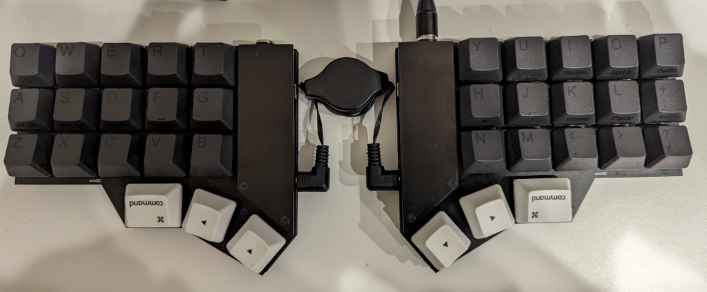

# 小石 (miniEC)

小石(miniEC) is a electrocapacitive split keyboard inspired by Manta40([KamoNanban](https://github.com/KamoNanban)), CorneEC([sekigon-gonnoc](https://github.com/sekigon-gonnoc)) and EC Helix([ginjake](https://github.com/ginjake)).

ビルドガイド

- [prototype, ~v1](https://github.com/goropikari/miniEC/blob/prototype/README.md)
- [v1~](docs/build_guide.md)

[販売ページ](https://pikarikbd.booth.pm/items/4799710)

## キャリブレーション版

`make build-calibration` で QMK 公式の [`qmkfm/base_container`](https://hub.docker.com/r/qmkfm/base_container) をベースに、Vial 対応ファームウェアをコンテナ内でビルドできます。
ブラウザでキーごとの押下・解放閾値を調整するには、[キャリブレーション版の手順](keyboards/miniec/readme.md)を参照してください。

## ファームウェアの配布

ビルド済みの HEX は [GitHub Releases](https://github.com/goropikari/miniEC/releases) の Assets から入手できます。
このワークフローを含むコミットに `v1.2.3` のようなタグを付けて push すると、GitHub Actions が次の処理を実行します。

1. `.devcontainer/Dockerfile` から Vial のビルド用イメージを作成し、GitHub Container Registry (GHCR) の `ghcr.io/goropikari/miniec-builder` に実行ごとのタグで保存します。
2. GHCR からそのイメージをダイジェスト指定で取得し、全キーマップをビルドします。
3. タグの Release に各配列の `miniec_<keymap>.hex` と、使用したイメージのダイジェストとソースのコミットを記録した `miniec-build-info.txt` を添付します。

過去のリリースと同じビルド環境を使えるよう、リリースで使ったイメージは GHCR に残してください。GHCR が非公開の場合、ローカルから取得するにはパッケージの読み取り権限が必要です。

License

- keyboards/miniec/, build/, docker_build.sh: GNU General Public License v3.0
- 3d_model/, plate/: [Creative Commons Attribution 4.0 International License](https://creativecommons.org/licenses/by/4.0/)
