# 小石(miniEC) Build Guide

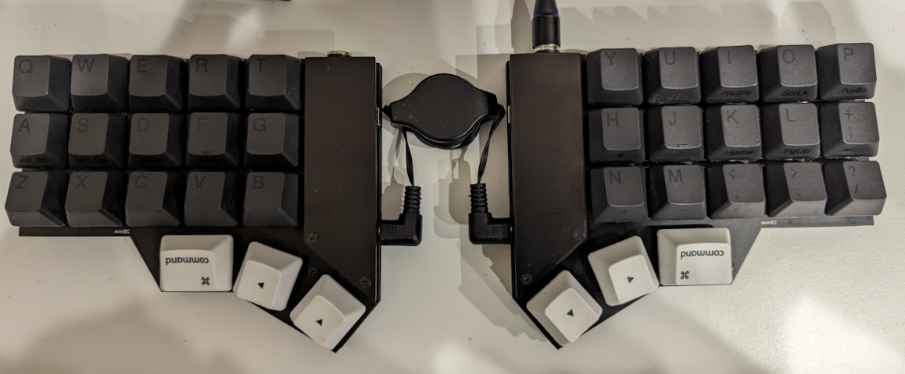

[販売ページ](https://pikarikbd.booth.pm/items/4799710)

- [小石(miniEC) Build Guide](#小石miniec-build-guide)
  - [部品](#部品)
    - [キット同封物](#キット同封物)
    - [その他必要なもの](#その他必要なもの)
  - [実装](#実装)
    - [表裏](#表裏)
    - [ProMicro・TRRS ジャック・タクトスイッチのハンダ付け](#promicrotrrs-ジャックタクトスイッチのハンダ付け)
    - [スイッチ](#スイッチ)
      - [NIZ のスイッチの場合](#niz-のスイッチの場合)
      - [BTO のスイッチの場合](#bto-のスイッチの場合)
      - [東プレスイッチ(Realforce) の場合](#東プレスイッチrealforce-の場合)
      - [すべてのスイッチ共通](#すべてのスイッチ共通)
    - [ProMicro カバー](#promicro-カバー)
    - [メイン基板・ボトムプレート・ゴム足](#メイン基板ボトムプレートゴム足)
  - [ファームウェアの書き込み](#ファームウェアの書き込み)
    - [HEX を用意する](#hex-を用意する)
    - [左右の Pro Micro に書き込む](#左右の-pro-micro-に書き込む)
    - [入力を確認してキー配列を設定する](#入力を確認してキー配列を設定する)
    - [閾値を調整する](#閾値を調整する)
    - [トラブルシューティング](#トラブルシューティング)
  - [オプション](#オプション)
    - [ケース](#ケース)
    - [プレートデータ](#プレートデータ)

## 部品

### キット同封物

| 名前                | 数量 |
| ------------------- | ---- |
| メインPCB           | 2    |
| トッププレート      | 2    |
| ボトムプレート      | 2    |
| マイコンカバー      | 2    |
| TRRS ジャック ※     | 2    |
| タクトスイッチ ※    | 2    |
| M2, 8 mm スペーサー | 14   |
| M2, 5 mm ねじ       | 28   |
| M4, 2 mm スペーサー | 10   |
| ゴム足              | 8    |

※ はんだ付け済みの場合は同封されていません。

### その他必要なもの

| 名前                                        | 数量     | 備考                                                                                                                                                                                                                                 |
| ------------------------------------------- | -------- | ------------------------------------------------------------------------------------------------------------------------------------------------------------------------------------------------------------------------------------ |
| ProMicro                                    | 2        | 動作確認済みは以下です<br>- https://shop.yushakobo.jp/products/pro-micro<br>- https://talpkeyboard.net/items/62e24e6f8a0bd07fe2d38137                                                                                                |
| 2.5~3.5 mm 12pin ピンヘッダー or コンスルー | 4        | ピンヘッダーであれば ProMicro を購入するとおそらく同封されています。コンスルーは遊舎工房や TALP KEYBOARD から購入できます。<br>- https://shop.yushakobo.jp/products/31 <br>- https://talpkeyboard.net/items/5e056626d790db16e2889233 |
| スイッチ                                    | 36キー分 | 使用できるスイッチに関しては「[動作確認済みスイッチ](switch.md)」をご参照ください                                                                                                                                                    |
| キーキャップ                                | 36キー分 | NIZ, BTO のスイッチだと CherryMX 用のものが使えます                                                                                                                                                                                  |
| TRRS or TRS ケーブル                        | 1        | - https://shop.yushakobo.jp/products/trrs_cable<br>- https://www.amazon.co.jp/gp/product/B08T5TT859/                                                                                                                                 |

## 実装

### 表裏

チップがすでにはんだ付けされている面が裏です。

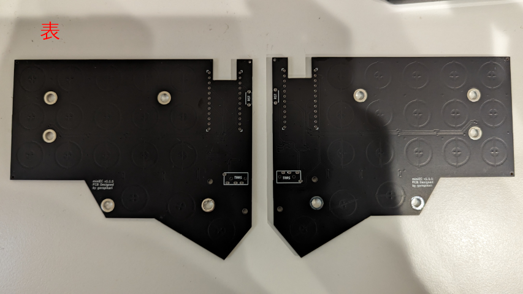

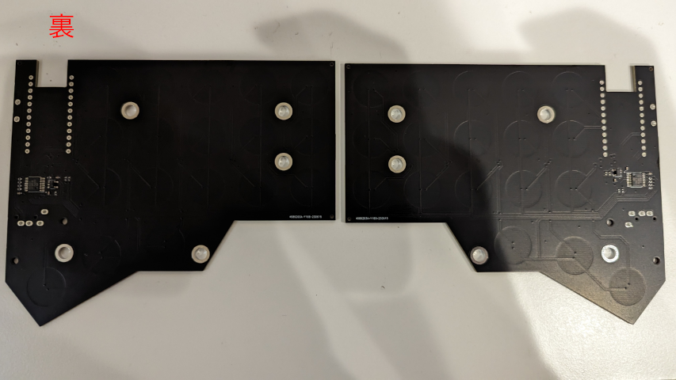

### ProMicro・TRRS ジャック・タクトスイッチのハンダ付け

写真のように ProMicro、TRRS ジャック、タクトスイッチ(リセットスイッチ)を配置しハンダ付けします。実装面をお間違えなきようお気をつけください。
最終的にチップが表面に出ないのが正しいです。

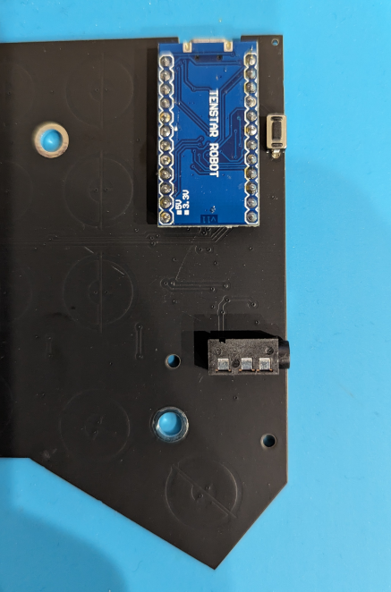

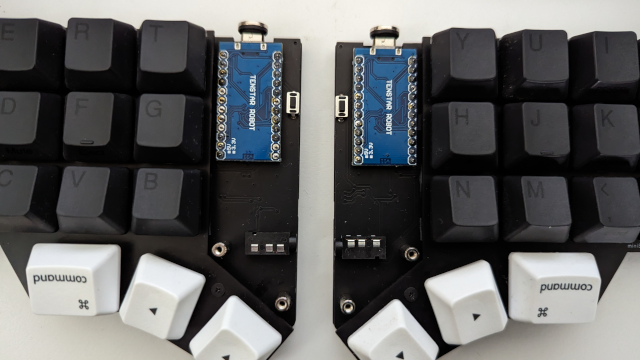

### スイッチ

トッププレートに M2, 8mm スペーサーをネジで固定します。

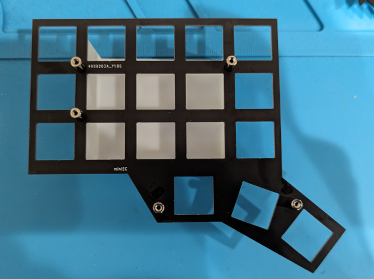

次にハウジングをトッププレートに嵌めていきます。(使用するハウジングに応じた記述に従ってください)

#### NIZ のスイッチの場合

ハウジングを下図のような向きにプレートに嵌めていきます。(NiZ のハウジングの場合はあまり向きにシビアではありませんが、中央にくるように配置してください。)

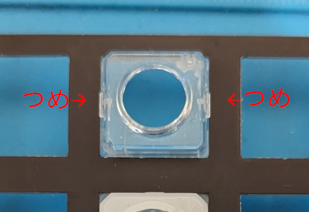

ハウジングを全て嵌めたらプランジャーをハウジングに入れていきます。プランジャーはハウジングのレールに沿うように入れてください。

正しい向き<br>
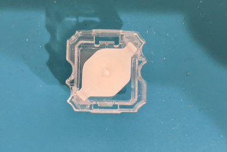

間違った向き<br>
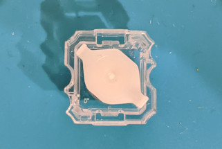

トッププレートの穴の大きさの影響でプランジャーの滑りが悪くなることがあります。その場合は穴をヤスリで削って拡張してください。

#### BTO のスイッチの場合

プランジャーに O リングを通し、プランジャーを嵌めます。プランジャーはハウジングのレールに沿うように入れてください。

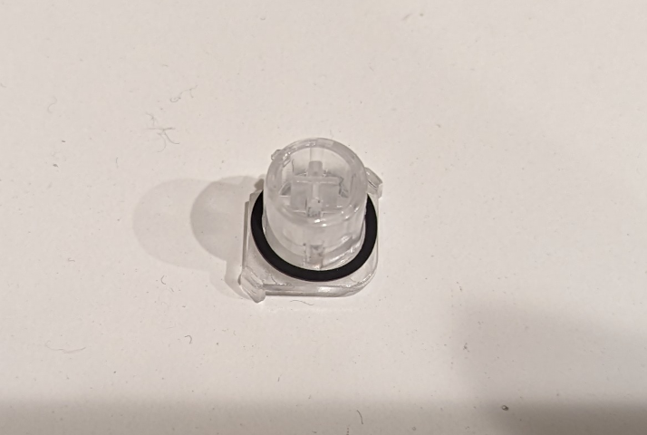

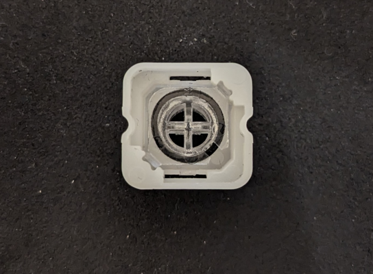

ハウジングを下図のような向きにプレートに嵌めていきます。爪が引っかかる向きに注意してください。(穴のサイズ的に間違った向きにはそもそもハマりません)

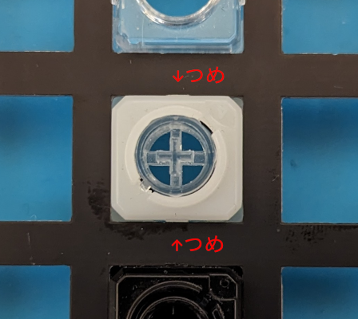

スペーサーが隅にある部分ではハウジングサイズが大きいためスペーサーと干渉します。その部分はハウジングの角をニッパーで切ったり、ヤスリで削ってください。(下の写真は東プレスイッチですが BTO のスイッチでも同様のことが起こります。)

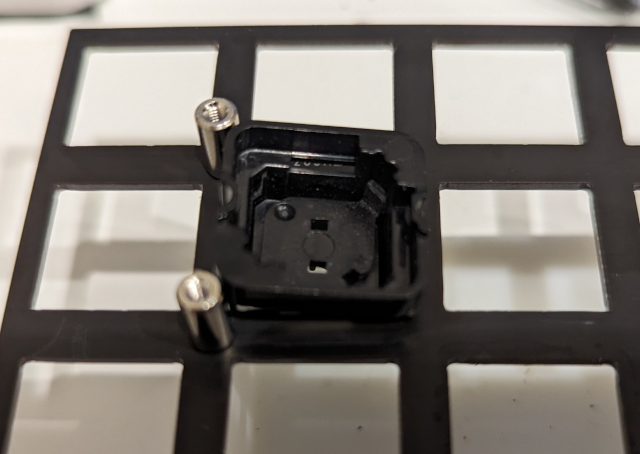

トッププレートの穴の大きさの影響でプランジャーの滑りが悪くなることがあります。その場合は穴をヤスリで削って拡張してください。

#### 東プレスイッチ(Realforce) の場合

Realforce を分解しハウジング等を入手します。
ハウジングを下図のような向きにプレートに嵌めていきます。爪が引っかかる向きに注意してください。(穴のサイズ的に間違った向きにはそもそもハマりません)

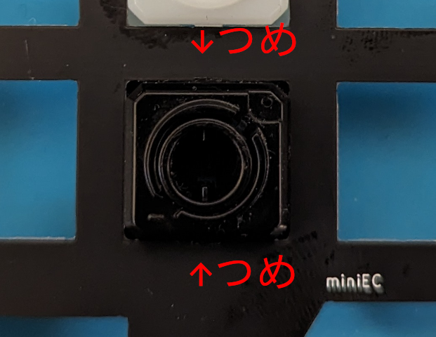

スペーサーが隅にある部分ではハウジングサイズが大きいためスペーサーと干渉します。その部分はハウジングの角をニッパーで切ったり、ヤスリで削ってください。


トッププレートの穴の大きさの影響でプランジャーの滑りが悪くなることがあります。その場合は穴をヤスリで削って拡張してください。

#### すべてのスイッチ共通

ラバーシートから5スイッチ分ずつ6行分と親指キー用を1スイッチ分ずつハサミで切り出します。
片手分の切り出し方の例として下の写真の赤線で囲った部分のように切り出すのがおすすめです。
全てを1スイッチ分ずつ切り分けたほうが後述する穴あけがやりやすいですが、コニカルスプリングがずれやすくなるのでまとめて切り出したほうが入力が安定します。

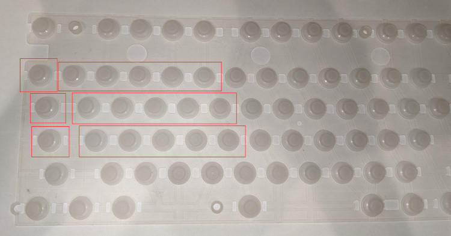

(オプション) ラバーシートの側面に穴を開けると打鍵が軽くなります。一方でタクタイル感が減りリニアに違い打鍵感になります。

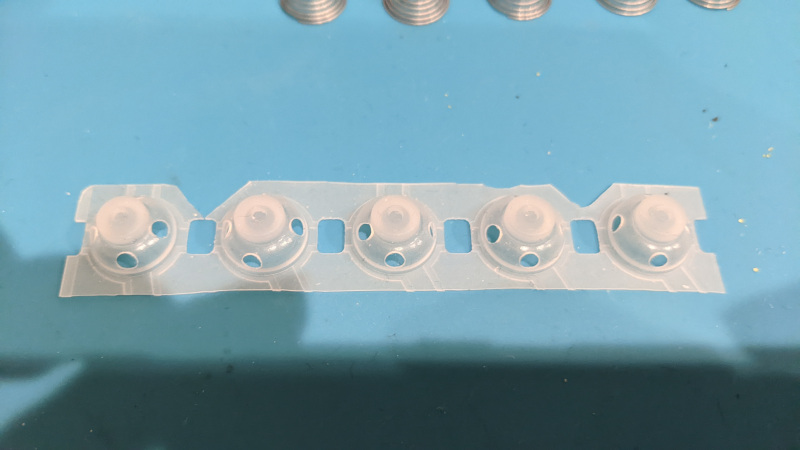

切り出したラバーシートをスイッチに乗せ、コニカルスプリングを1つずつ配置します。コニカルスプリングは重なりやすいので1つずつになっていることを確認しながら配置してください。重なっていた場合入力がおかしくなることがあります。この時テーブルに直置きした状態で作業するとうまくハメられないため基板を浮かせた状態にしてください。
名刺やカードの短辺がおおよそ3キー分くらいの長さなのでプラスチック製のカードケースなどが使えると思います。
この作業のためだけの[スタンドの 3D モデルも用意](3d_model/stand.stl)しているため 3D プリンターを所有されている方は印刷して使用してみてください。

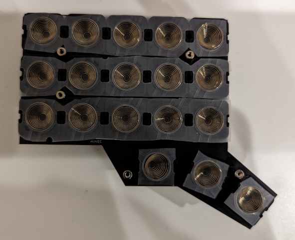

プランジャーが落ちきった状態で作業をする。

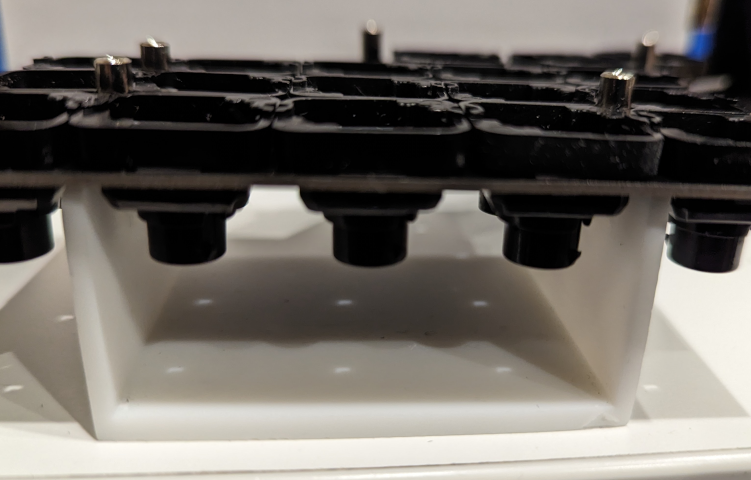

### ProMicro カバー

左右用のカバーが一つの基板として連結しているので切り離し、バリをヤスリで削ってください。

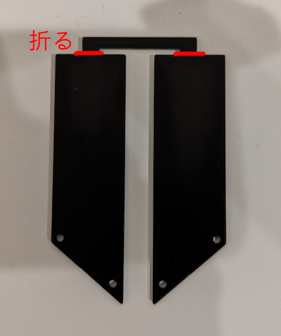

PCB に M2 8 mm スペーサーを取り付け、カバーをネジで固定してください。

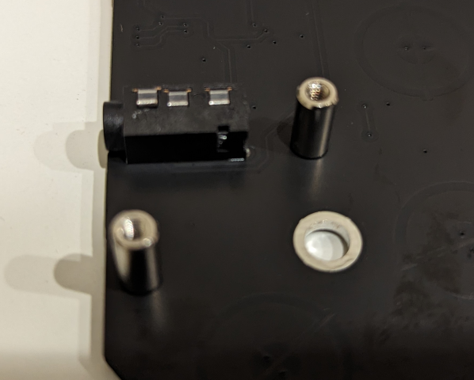

### メイン基板・ボトムプレート・ゴム足

トッププレートにメイン基板を乗せ、スペーサーのところに M4 2 mm スペーサーをおいてください。
最後にボトムプレートをかぶせネジで止め、ゴム足を貼り付けてください。

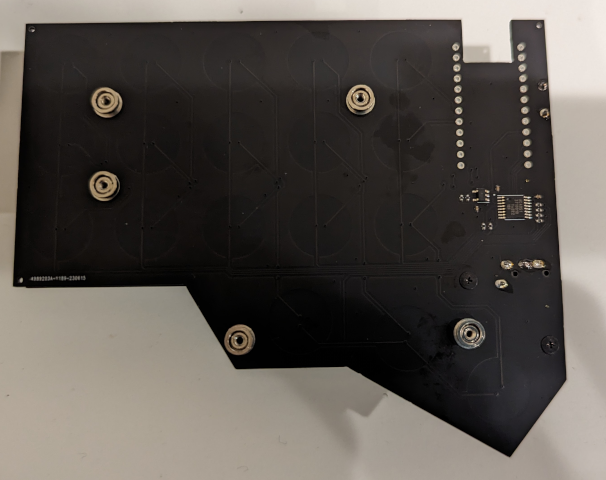

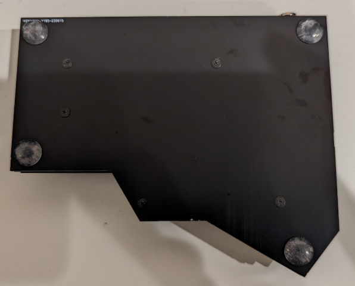

## ファームウェアの書き込み

miniEC の全7キーマップは Vial 対応です。同じファームウェアで、Vial によるキー割り当てとブラウザによる押下・解放閾値の調整ができます。

### HEX を用意する

[GitHub Releases](https://github.com/goropikari/miniEC/releases) を開き、Assets から使いたい配列の `miniec_<keymap>.hex` をダウンロードします。組み立て直後の入力確認には `miniec_test.hex`、使いたい配列が決まっていれば `miniec_qwerty.hex` などを選びます。

Assets がない場合や自分でビルドする場合は、Docker を起動してリポジトリのルートから実行します。

```sh
make build
```

Docker 内の Vial-QMK で全キーマップをビルドし、`build/` に HEX を生成します。1種類だけビルドする場合は、たとえば `./docker_build.sh miniec:test` を実行します。

### 左右の Pro Micro に書き込む

1. [QMK Toolbox](https://github.com/qmk/qmk_toolbox) の **Open** で書き込む HEX を選び、**Auto-Flash** にチェックを入れます。
2. USB を抜いて電源を切り、左右をつなぐ TRRS ケーブルを外します。片側だけを USB で PC に接続します。
3. 本体のリセットスイッチを押します。直後にブートローダーが検出されない場合は、素早く2回押してください。QMK Toolbox が Caterina を検出すると、自動で書き込みが始まります。ログで完了を確認します。
4. 書き込みが終わったら USB を抜き、もう片側にも同じ HEX を書き込みます。左右の書き込みが済んだら、電源を切った状態で TRRS ケーブルをつなぎ直します。

Linux でコマンドから書き込む場合は、たとえば `./docker_build.sh miniec:test:flash` を実行し、リセットを求める表示が出てから本体のリセットスイッチを押します。左右それぞれに実行してください。

すでに使っている個体を更新する場合は、先に Vial のキーマップと、対応版なら調整ツールの保存済み閾値をバックアップします。既存の閾値は各側の EEPROM にあるので、引き継ぐ場合は上記の物理リセットで書き込みます。キーを押しながら USB をつなぐ Bootmagic や、QMK Toolbox の **Reset EEPROM** は保存済み設定を消します。[Caterina の書き込み手順](https://docs.qmk.fm/flashing#caterina) · [Bootmagic](https://docs.qmk.fm/features/bootmagic)

### 入力を確認してキー配列を設定する

`miniec_test.hex` を使った場合は、テキストエディタなどを開いてすべてのキーが反応することを確認します。反応しないキーがあれば、[閾値を調整する](#閾値を調整する)を参照してください。

入力確認が済んだら、使いたい配列の HEX を左右に書き込むか、Vial で割り当てを変更します。全キーマップが Vial に対応しているので、キー割り当ての変更のたびに再ビルドする必要はありません。[Vial の案内](vial.md)

### QMK Toolbox の HID Console で測定値を見る

1. 測定したい側に `miniec_test.hex` を書き込みます。HID Console への出力は `test` キーマップで有効です。
2. USB を抜いて電源を切り、左右をつなぐ TRRS ケーブルを外します。測定したい側を USB で PC に直接接続し、QMK Toolbox の **HID Console** を開きます。反対側も調べる場合は、そちらを USB で直接接続します。[QMK Toolbox の HID Console](https://github.com/qmk/qmk_toolbox#hid-console)
3. 接続した側の測定値が、マトリクス順に3行×6列で繰り返し出力されます。値は ADC 生値を4で割った整数（0〜255）です。キーを一つ押して数字が変わる位置を探し、同じ位置の値を離した状態と押した状態で見比べます。

押下・解放時には `KL:` で始まる打鍵ログも流れます。`pressed: 1` は押下、`pressed: 0` は解放です。測定値を見て閾値を変更する場合は、次の手順でブラウザの調整ツールを使います。

### 閾値を調整する

デスクトップ版 Chrome または Edge で [miniEC 閾値調整（GitHub Pages）](https://goropikari.github.io/miniEC/) を開き、調整したい側を USB で直接接続して「miniEC に接続」を押します。アナログ測定値を見ながら、キーごとの押下・解放オフセットを変更できます。離した状態と押した状態を測って推奨値を出すこともできます。

調整した値は「この側の設定を保存」で EEPROM に記録します。反対側も調整する場合は、そちらを USB で直接接続します。ローカルで起動する方法も含め、詳しくは[閾値調整ツールの使い方](../keyboards/miniec/readme.md#ブラウザで閾値を調整する)を参照してください。

### トラブルシューティング

うまく機能しない場合に調査すべきポイントを [wiki](https://github.com/goropikari/miniEC/wiki/%E3%83%88%E3%83%A9%E3%83%96%E3%83%AB%E3%82%B7%E3%83%A5%E3%83%BC%E3%83%86%E3%82%A3%E3%83%B3%E3%82%B0) にまとめています。

## オプション

### ケース

小石用ケースの 3D モデルを配布しております。[左用](../3d_model/case-left.stl), [右用](../3d_model/case-right.stl)。

ご家庭の 3D プリンター、もしくは専門の業者に依頼して印刷してご使用ください。
こちらのケースはボトムプレートの代わりにご使用ください。その際、M4 2 mm スペーサーは使わないでください。

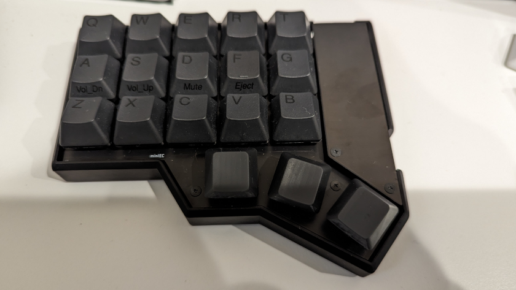

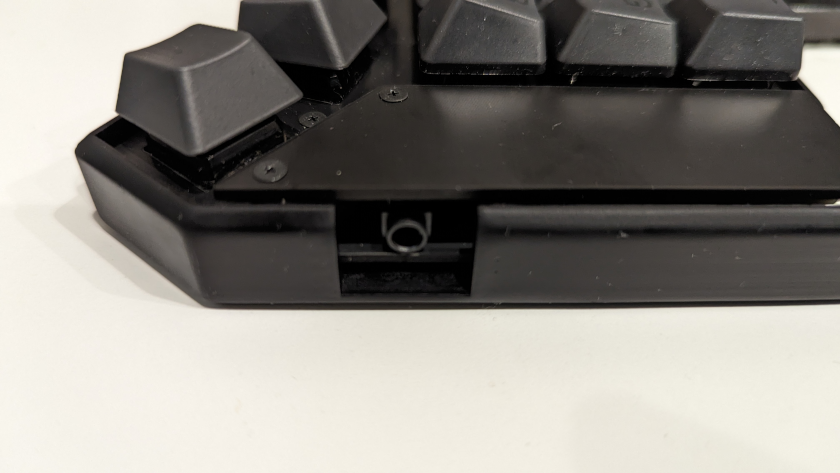

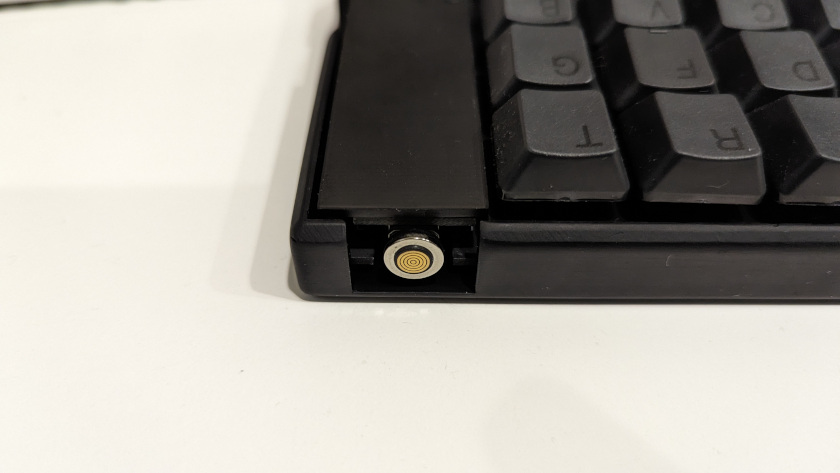

写真のケースは JLCPCB Resin Imagine Black で作りました。

### プレートデータ

ご自身でケースを作成されたい方は[ボトムプレートのデータ](../plate/)を KiCad, svg 形式で配布しておりますのでご活用ください。
